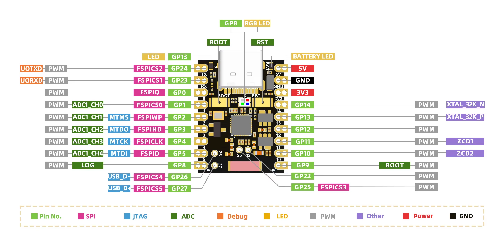

# H2 Zigbee sound detector

ESPHome 2026.11.1 project for the pictured ESP32-H2 SuperMini,
MS3625 I²S microphone, and Home Assistant **ZHA**. Detection is entirely local;
Zigbee carries interval summaries and detection state, never raw audio. USB
power is intended: continuous microphone processing is not a low-power design.
The H2 has no Wi-Fi, so this project does not depend on a WiFi network.

The board used in development of this project was "ESP32-H2 Supermini Development Board Single-chip Machine Programming Learning Controller core board" from AliExpress, which has the pinout shown below.



## Wiring

Disconnect power before wiring. Pins are GPIO numbers printed on the supplied
board diagram; SPI/JTAG alternate-function labels do not reserve these pins.

| MS3625 | H2 board |
|---|---|
| VDD | 3V3 |
| GND | GND |
| SCK | GPIO4 |
| WS | GPIO5 |
| SD | GPIO12 |
| L/R | GND |

Use short leads and 3.3 V power for the microphone. GPIO4/5/12 leave the USB
pins 26/27, BOOT pin 9, UART pins 23/24, and board LEDs unused by I²S.
The board profile `esp32-h2-devkitm-1` supplies the H2 target; the explicit pin
assignments follow your pictured board, not the DevKit header layout.

Capture remains 32 kHz with two 32-bit stereo slots, selecting **index 1** and
shifting right 16 bits to signed PCM16, matching the proven original setup.
This uses ESP-IDF's standard I²S API because the H2 differs from the original
ESP32. The slot must still be verified on the new hardware: compare filtered
level during quiet and buzzer playback. Do not infer a slot change from L/R
being grounded. Do not reuse the original ESP32 GPIO26/25/33 wiring.

## Build and flash separately

From this directory:

```bash
python3 -m venv .venv
.venv/bin/pip install -r requirements.txt
.venv/bin/esphome config buzz-detector.yaml
.venv/bin/esphome compile buzz-detector.yaml
```

This project was configuration-validated and compiled with ESPHome 2026.11.1
and its ESP-IDF 5.5.6 toolchain. It has **not** been flashed or tested on the
physical H2, paired with ZHA, or verified with Alexa yet. Pin naming, microphone
slot, performance, and actual ZHA entity creation require hardware validation.
The compiler reports the expected GPIO9 strapping-pin warning for the board's
built-in BOOT button; do not add external pull resistors to that button.

When ready to flash yourself, use ESPHome's USB workflow, for example:

```bash
.venv/bin/esphome upload buzz-detector.yaml --device /dev/ttyACM0
.venv/bin/esphome logs buzz-detector.yaml --device /dev/ttyACM0
```

Replace the USB device path as appropriate. If initial USB detection fails,
hold BOOT while resetting to enter the ROM bootloader, then release BOOT.
No network API, Wi-Fi OTA, or Zigbee OTA update implementation is included;
use USB for firmware changes. Do not hold BOOT during reset except to flash.

## Join ZHA

1. Enable adding devices in Home Assistant's ZHA integration.
2. Power/reset the H2. An unpaired device attempts to join the Zigbee network.
3. Allow the device interview to finish, then inspect its entities. Endpoints
   1–7 are measurements/diagnostics, 8–9 are detection/readiness, and 10–17
   are adjustable numbers. Names and entity IDs may vary with ZHA version.
4. To erase pairing, hold the board's BOOT button for five seconds **after the
   firmware has started**. This runs ESPHome's Zigbee factory-reset action.
   Then enable ZHA joining and restart if necessary. This does not reset the
   persisted detector number settings; change those through ZHA.

This is a non-sleepy Zigbee end device, not an additional Zigbee router.
Generic Analog Input/Output and Binary Input clusters carry measurements,
settings and states. Entity support follows ESPHome/ZHA: verify that the eight
settings are writable in your installation before relying on remote tuning.
Keep endpoint assignments stable once paired; changing endpoint structure
may require removal and re-pairing. Supported entities use forced reporting
so ZHA's ordinary sensor reporting interval cannot delay an alert by 30 seconds.

## Detection and tuning

`detector_core.h` implements a causal second-order Butterworth high-pass and
RMS measurement, with no per-sample heap allocation or FFT. Input is relative
PCM full scale; reported dB values are **dBFS, not calibrated dB SPL**. No
normalization or automatic gain is applied.

| Parameter | Default | Meaning |
|---|---:|---|
| Measurement Interval | 500 ms | Nonoverlapping sample-counted RMS windows |
| Lookback | 5 s | Compare against the window this far in the past |
| Rise Threshold | 12 dB | Required increase above that past level |
| Required Intervals | 5 | Consecutive qualifying windows (2.5 s by default) |
| Minimum Level | −60 dBFS | Absolute filtered level gate |
| Highpass Cutoff | 2500 Hz | 12 dB/octave high-pass; 0 bypasses filtering |
| Release Intervals | 1 | Consecutive nonqualifying windows to clear detection |
| Cooldown | 10 s | Suppress another detection after release |

These eight numbers are persisted by ESPHome and restored after reset.
`initial_value` in YAML is the first-use default, not an override for restored
settings. The order of `controls` in YAML matches the documented parameter
order; do not reorder it. Pin numbers and slot selection are YAML settings.

The lookback is rounded to the nearest whole measurement interval, with a
minimum of one interval. History supports up to 30 seconds at 100 ms windows.
For a long sound, after the lookback duration the historical window also
contains that sound, reducing the rise even if the sound continues. Choose
lookback longer than the required persistence for the intended sound. This
implementation uses the requested delayed-window comparison, not a frozen
or adaptive baseline. Startup and configuration changes require history
warmup; `Baseline Ready` remains off until a past window is available.

A successful detection turns `Buzzer Detected` on, clearing it after the
release criterion. It is a **binary sensor**, not a physical relay or a
writable switch. Latch a separate finished indicator in Home Assistant if
needed. Changing parameters resets detection/history rather than mixing
measurements made with different settings.

RMS windows are 500 ms by default, but numeric telemetry is sent every **2 s**
(`report_period` substitution). Set `report_period: 500ms` temporarily for
fine-grained tuning; avoid needless long-term Zigbee traffic/HA history.
Binary state changes are published immediately from the main loop. Filtered
Level, Baseline Level, Level Rise and Qualifying Intervals are the main tuning
measurements. Before warmup, baseline/rise are NaN (may display unavailable).

Capture runs in a priority-5 FreeRTOS task. A bounded 16-result queue transfers
only window summaries to the ESPHome loop, where all entity/Zigbee operations
occur. Queue and task allocations occur at startup. I²S read errors/timeouts,
zero-byte reads, and driver RX queue overflows reset history and clear
qualification instead of joining audio across a known discontinuity.
`Capture Errors`, `DMA Overflows`, and `Result Drops` are cumulative counters.
A main-loop result-queue overflow triggers a baseline rebuild when consumed;
this is fail-closed and may miss an event rather than trust incomplete results.
Driver notifications do not guarantee detection of every hardware loss.

## Home Assistant and Alexa

See `home-assistant.example.yaml` for a latch automation and a template contact
sensor for Alexa. Replace the example entity IDs with ZHA's actual IDs and
merge each top-level section into the appropriate HA configuration. The example
preserves unavailability rather than treating an offline sensor as a normal off.

Expose the template contact sensor through your existing HA Cloud/Alexa Smart
Home integration. Create an Alexa routine triggered when it **opens/on**,
with an announcement such as “Your washing machine has finished”. Contact
open/on is the trigger convention, independent of a simulated closed switch.
Proactive events must be enabled where your Alexa integration requires them.
Direct pairing to an Echo is not the intended integration path.
A separate HA input boolean can remain on until laundry is acknowledged and
can control a light. Verify the Alexa routine manually before unattended use.

## Replay and hardware acceptance

```bash
python3 tests/run_tests.py
python3 tests/run_tests.py --wav ../wifi-audio-streamer/esp32-ms3625-audio/receiver/spin_cycle_and_buzz.wav
```

Requires a host C++17 compiler (`g++`); WAV replay uses only Python's standard
library. The tests compile and run the exact embedded core. The supplied
331.648-second recording produces **ON at 213.5 s, OFF at 215.0 s**, with no
other detections. Tests cover history warmup, impulse-window rejection,
consecutive persistence, minimum level, release, reset, filter response, and
cooldown. The expected replay result is specific to this fixture; omit `--wav`
for generic unit tests. Test other recordings separately before changing the
fixture expectation.

The earlier `analyze_recording.py`/`analysis.csv` use windowed spectral estimates,
not the causal implementation. Those estimates identify useful energy near
5–6 kHz and substantial energy beyond 7 kHz; the firmware therefore defaults
to high-pass only. A band-pass, frozen baseline, or spectral classifier can be
added later if more recordings reveal false positives.

On hardware: verify microphone levels first, wait for baseline readiness,
check actual measurements/settings in ZHA, then play the buzzer at realistic
volume and distance. Confirm one detected event, and no detections from door
slams/switch clicks or a full spin-only cycle. Verify all three error counters
remain unchanged. Test parameter changes, power-cycle restoration, coordinator
outages, joining/rejoining, and finally the Alexa announcement/light. A single
positive recording is not enough to establish false-positive performance.

References: [ESPHome Zigbee](https://esphome.io/components/zigbee/),
[ESP32-H2 I²S](https://docs.espressif.com/projects/esp-idf/en/v5.5/esp32h2/api-reference/peripherals/i2s.html),
[Home Assistant Alexa](https://www.home-assistant.io/integrations/alexa.smart_home/#binary-sensor).
